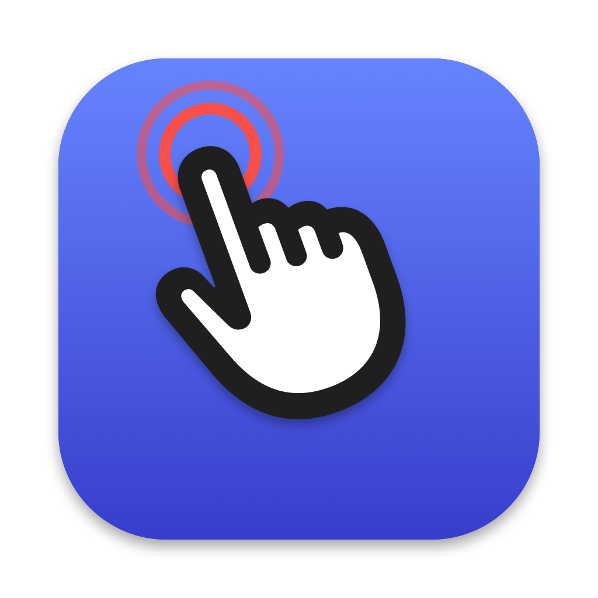
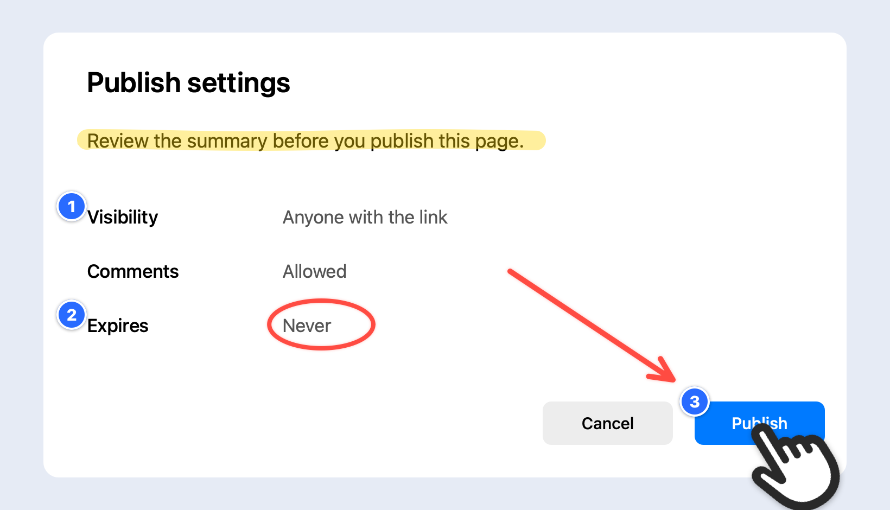
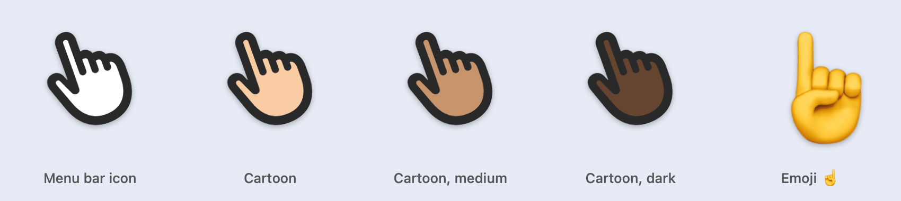
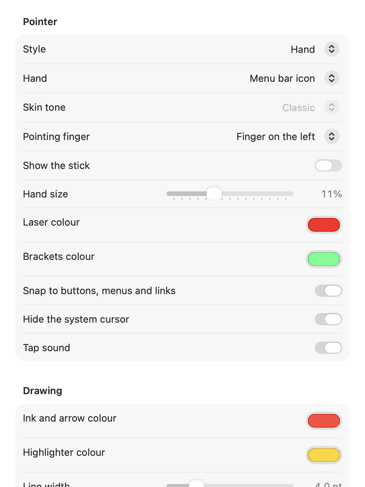

# Fingertip



A big pointing hand for presenting on your Mac. Point at things, draw,
highlight, add arrows, spotlight part of the screen and number your steps
while you share your screen or record a demo.

**Website and live demo:** [rockykusuma.github.io/Fingertip](https://rockykusuma.github.io/Fingertip/)

Inspired by [TinyHand](https://github.com/nilbuild/tinyhand) by Kamran Ahmed.
Written from scratch.

macOS 13+, Apple Silicon and Intel. Swift, AppKit, Core Animation. No
dependencies.



## Install

1. Download `Fingertip-<version>.dmg` from
   [Releases](https://github.com/rockykusuma/Fingertip/releases/latest), open
   it, and drag **Fingertip** onto **Applications**.
2. Open Fingertip. macOS will say it can't verify the developer, because the
   app isn't notarized (that needs a paid Apple Developer account). Click
   **Done**, then open **System Settings → Privacy & Security**, scroll down
   and click **Open Anyway** next to Fingertip. You only do this once.
3. Fingertip lives in the menu bar. Click the hand icon or press **⌃⌥H** to
   turn the pointer on, and allow **Accessibility** when asked. That's what
   lets a click become a tap of the hand instead of a click on the app below.

## Build from source

```sh
./build.sh
open dist/Fingertip.app
```

`build.sh` signs with the first "Apple Development" identity in your
keychain, so macOS remembers the Accessibility grant across rebuilds. With
no such identity it falls back to ad-hoc signing, and you re-grant
Accessibility after every rebuild. `./release.sh` builds the universal DMG.

## Use

| Action | Effect |
|---|---|
| Click menu bar icon, or **⌃⌥H** | Pointer on / off |
| Right-click menu bar icon | Menu, including **Settings…** |
| Click | Tap (nothing underneath is clicked) |
| Hold and drag | Draw (press harder on a Force Touch trackpad for a thicker line); strokes fade a few seconds after you let go |
| **⌘** + click or drag | Click through: the app underneath gets a plain click (⌘ removed) and a ripple shows it |
| **⇧** + drag | Straight arrow from where you pressed to where you let go |
| **⌥** + drag | Highlighter: a wide see-through stroke (yellow by default) |
| **⌃⌥L** | Cycle pointer: hand → laser dot → lock-on brackets |
| **⌃⌥S** | Spotlight on / off (dims all but a circle around the pointer) |
| **⌃⌥A** | Snap to elements on / off (hand magnetises to buttons, menu items, links; label shows what it is) |
| **⌃⌥N** | Step stamps on / off: each tap drops a numbered badge 1, 2, 3… (on a snapped button's top-left corner); they stay until cleared |
| **⌃⌥X** | Clear drawing and stamps (numbering restarts at 1) |
| **Esc** | Clear and turn pointer off |

Clicks on the menu bar icon still go through while the pointer is on.

## Settings

Right-click the menu bar icon → **Settings…**. Changes apply instantly and are
remembered:

- **Pointer**: style; hand (the menu bar icon's hand in white, the same hand
  in a skin tone, or the ☝️ emoji); skin tone; which side the finger is on (left like
  the menu bar icon, right like ☝️, or auto: flips so the palm faces the
  nearer side edge); whether to show the stick; hand size; laser and brackets colours; snapping; hiding the system
  cursor; tap sound
- **Drawing**: ink and arrow colour, highlighter colour, line width, fade delay (or never)
- **Spotlight**: size and darkness
- **Step stamps**: badge colour
- **General**: open at login, reset to defaults, and a shortcuts reference

The pointer can stay on while Settings is open; clicks on Fingertip's own
windows go through to them.

## Hands





## Code map

```
Sources/Fingertip/
  main.swift              NSApplication bootstrap, accessory policy
  AppDelegate.swift       menu bar item, hotkey wiring, activation flow
  OverlayController.swift one click-through NSWindow per screen; frame loop
  PointerLayer.swift      the hand (menu bar symbol or emoji, mirrored as set), stick, laser
  SpotlightLayer.swift    dim mask with a hole that follows the cursor
  AXProbe.swift           Accessibility hit test: clickable element under a point
  SnapLayer.swift         outline + label pill for the snapped element
  ReticleLayer.swift      lock-on brackets that clamp onto the snapped element
  StampLayer.swift        numbered step badges for walkthroughs
  ClickRipple.swift       the ring shown for each ⌘ click that goes through
  InputTap.swift          CGEvent tap: swallows left clicks, or passes them through with ⌘
  HotKeys.swift           Carbon RegisterEventHotKey wrapper
  CursorHider.swift       hides the system cursor while active
  TapSound.swift          click sound
  Prefs.swift             settings on UserDefaults, hand kinds, skin tones
  SettingsView.swift      SwiftUI Settings window
  InkLayer.swift          pen, arrow and highlighter strokes
scripts/make-icon.swift   renders the app icon (then iconutil → Resources/AppIcon.icns)
build.sh                  builds and signs dist/Fingertip.app
release.sh                universal build → dist/Fingertip-<version>.dmg
docs/                     the website (GitHub Pages from main /docs) and README images
```

How it works: the overlay windows sit above everything
(`level = screenSaver + 1`, `.canJoinAllSpaces`, `.fullScreenAuxiliary`) and
ignore mouse events. A 120 Hz timer reads `NSEvent.mouseLocation` and moves the
hand. A session-level `CGEvent` tap on its own thread intercepts
left-down/drag/up plus Force Touch pressure events (NSEvent type 34, which
`CGEventMask` happily accepts): the tap animates the hand and feeds the ink,
and returns `nil` so the event never reaches the app underneath. Everything else — right
clicks, keyboard, scrolling — passes through untouched.

Click-through: a press that starts with ⌘ held is passed to the app, along
with its drag and release, with the ⌘ flag removed so the app sees a plain
click. The press callbacks still fire to squash the hand, drop a ripple, and
count step stamps.

Snapping: every 6th frame (~20 Hz) a background queue asks the Accessibility
API what is under the cursor. If it is a clickable role, the hand's goal
becomes the element's centre and it eases there; a tap lands where the hand
is, not where the cursor is.

## Roadmap

- [x] **Phase 0** — core: overlay, hand + laser, tap, ink, hotkeys
- [x] **Phase 1** — Spotlight mode: dim everything except a circle around the hand
- [x] **Phase 2** — Force Touch ink: `NSEvent.pressure` → stroke width
- [x] **Phase 3** — Snap-to-element + AX inspector: `AXUIElementCopyElementAtPosition`,
      hand snaps to buttons/menu items, tooltip shows role/title
- [ ] ~~**Phase 4** — Record & replay~~: built, then removed; not useful in practice
- [ ] ~~**Phase 5** — Voice control~~: built, then removed; it didn't earn its
      place in real use

## License

MIT
